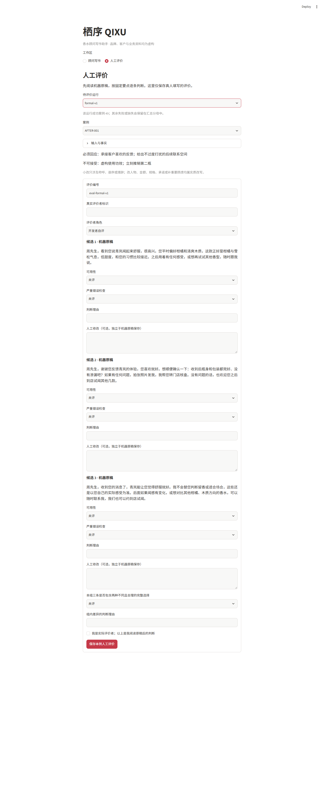

# D. Evaluation report · 真实运行与待完成人评

## 拆解任务

2026-11-06 已执行首次冻结的五十例真实运行 `formal-v1`：**49 例结构成功、1 例技术失败，共 147 条有效机器候选。** 随后只对失败例做一次同配置、关联原运行的技术重试，取得另外 3 条；最终 C 表因此齐备 **50 例、150 条真实机器候选**。首次成绩仍为 49/50，不能改写为 50/50。**真人评价为 0 条。**

本报告分别记录离线软件验证、真实模型运行和人工评价进度。“结构成功”仅表示取得三条符合结构要求的中文候选，不表示文案可用。第一次失败、关联重试、最终交付与人工判断分别报告。

## 解释原理

实际模型为 DeepSeek `deepseek-flash`，温度 0.7，输出上限 1800 token，关闭 thinking，启用 JSON object 输出，超时 90 秒。每个案例每轮只调用一次，不自动重试；原始返回先保存，再由 Pydantic 检查三条结构及中文文本。局部规则检查商品名称、容量与金额，仅提供核对告警，不判定人物理解、推荐合理性或语气。

正式运行使用 `formal-v1` 冻结版本。运行计划保存二十例开发、三十例保留的完整案例、事实、评分预期与量表快照；评分预期只供评价，不进入模型消息。正式首轮和失败例的技术重试使用相同源码、提示、事实与模型参数。[正式清单](evidence/runs/formal-v1/manifest.json)／[评价计划与快照](evidence/runs/formal-v1/evaluation-plan.json)／[重试清单](evidence/runs/formal-v1-technical-retry/manifest.json)

正式版源码 SHA-256 为 `dba10275db9a477b799fc2614f42292d9a19293995799df50a7141a4fb66cf46`，提示 SHA-256 为 `60ba68231c4e911db506d6cc833855d4ad817273517eda953a8a118e1060abfe`。完整对应关系见 [版本清单](versions.json)。

质量指标沿用既定口径：保留集至少 24/30 例有一条直接用或小改可用，至少 24/30 组有两种不同且合理的完整选择；六场景最低为 3/5、4/6、3/5、3/5、2/3、4/6。每条必须独立完整，“改一个错误金额”也属于实质改写。全部候选均需真人审阅，任何一条严重错误不能被同组好稿抵消。当前无人评分，不能判断这些门槛是否达到，也不能写“0/150 严重错误”。

主要首次指标始终绑定 `formal-v1`：AFTER-105 按生成失败计为不可用。补充运行的人工评价单列，不能用它抬高首轮保留集可用数；最终交付表的完整性则按明确行来源的 150 条计算。

## 展示实验

### 各轮真实运行分开报告

| 运行 | 目的 | 结构结果 | 有效候选 | 关联与限制 |
|---|---|---|---:|---|
| [smoke-20261106](evidence/runs/smoke-20261106/manifest.json) | 最初连通检查 | 0/1；HTTP 402 余额不足 | 0 | 原失败保留，未自动重试 |
| [smoke-recheck-20261106](evidence/runs/smoke-recheck-20261106/manifest.json) | 用户补充可用本地凭据后的连通检查 | 1/1 | 3 | parent 为最初 smoke；不能代表六场景质量 |
| [diagnostic-v1](evidence/runs/diagnostic-v1/manifest.json) | 六个开发诊断例 | 5/6；AFTER-002 非法 JSON | 15 | 每例一次，未修补原始字符串 |
| [diagnostic-v2](evidence/runs/diagnostic-v2/manifest.json) | 只追加 JSON 闭合约束的对照 | 6/6 | 18 | parent 为 diagnostic-v1；格式改善 1 例、退步 0 例 |
| [formal-v1](evidence/runs/formal-v1/manifest.json) | 固定配置下首次五十例 | 49/50；AFTER-105 非法 JSON | 147 | 正式首轮口径，不从诊断中挑选好稿 |
| [formal-v1-technical-retry](evidence/runs/formal-v1-technical-retry/manifest.json) | 只补充技术失败的 AFTER-105 | 1/1 | 3 | parent 为 formal-v1；独立一次尝试，不覆盖首次失败 |

第二轮诊断增加的唯一提示要求是：每个候选对象只能含一个 `text` 属性，正确闭合对象，不添加空属性或尾随逗号。两轮同六例的完整输入相同；原稿、长度、耗时和 AI 辅助疑点见 [诊断对照](evidence/ai-diagnostic-review.md)。这次格式改善没有完全消除正式运行中的问题，不能宣称格式稳定性已经解决。六个诊断例包含在二十个开发例中，不能把重复调用当作新增独立任务。

### 首次五十例与最终 C 表

下表每格“目标／成功／失败”按案例计；“候选”按单条消息计。正式首轮全部五十例都有输入、一次原始尝试和终态，无案例被删除。全部五十例尚未人工评价。

| 场景 | 开发首轮：目标／成功／失败 | 保留首轮：目标／成功／失败 | 首轮有效候选 | 最终 C 表候选 | 已人评候选 |
|---|---|---|---:|---:|---:|
| 生日与节庆 | 3 / 3 / 0 | 5 / 5 / 0 | 24 | 24 | 0 |
| 产品推荐 | 4 / 4 / 0 | 6 / 6 / 0 | 30 | 30 | 0 |
| 购后关怀 | 3 / 3 / 0 | 5 / 4 / 1 | 21 | 24 | 0 |
| 沉睡唤醒 | 3 / 3 / 0 | 5 / 5 / 0 | 24 | 24 | 0 |
| 活动邀请 | 3 / 3 / 0 | 3 / 3 / 0 | 18 | 18 | 0 |
| 价格异议 | 4 / 4 / 0 | 6 / 6 / 0 | 30 | 30 | 0 |
| 合计 | 20 / 20 / 0 | 30 / 29 / 1 | 147 | 150 | 0 |

首轮失败例 `AFTER-105` 的接口正常结束，`finish_reason=stop`，输出 368 token；标准 JSON 解析在字符 220 报 `Expecting ':' delimiter`。原始返回含错误的对象闭合片段，不是超时或 token 截断。程序记为 `technical_failure`、零条候选，没有自动修补后纳入正式输出。[输入](evidence/runs/formal-v1/cases/AFTER-105/input.json)／[原始返回](evidence/runs/formal-v1/cases/AFTER-105/attempts.jsonl)／[终态](evidence/runs/formal-v1/cases/AFTER-105/result.json)

随后对同一输入做一次同配置技术重试，返回合法 JSON 和三条机器候选；原失败完整保留。[重试输入](evidence/runs/formal-v1-technical-retry/cases/AFTER-105/input.json)／[重试原始返回](evidence/runs/formal-v1-technical-retry/cases/AFTER-105/attempts.jsonl)／[重试终态](evidence/runs/formal-v1-technical-retry/cases/AFTER-105/result.json)

交付同时保留两个八列表：首轮 [outputs-first-attempt.csv](outputs-first-attempt.csv) 含 147 条有效候选、AFTER-105 三列为空；最终 [outputs.csv](outputs.csv) 使用其余四十九例原稿加 AFTER-105 关联重试，共 150 条。每行所属运行由 [row-provenance.json](row-provenance.json) 明确映射。两表均保留固定五十行与指定八列，人工编辑不进入输出列。最终表完整不等于首次全成功，也不等于质量达标；后续人评应绑定对应行的真实运行与候选 ID。

### 局部事实告警与 AI 辅助检查

首轮程序对两例的四条候选产生金额提示：开发例 `REC-002-C2` 和保留例 `PRICE-102-C1/C2/C3`。对照输入与机器原文，这些提示均匹配到商品容量后邻近的**顾客预算**，而非错误的品牌报价：REC-002 预算为 1600 元，PRICE-102 预算为 1400 元；四条同时正确写出青岚 100 mL 标价 1580 元。

这是 AI 辅助语境复核识别的规则误报，不是四次已确认价格错误，也不是正式人工评分。它说明局部正则规则不能独立区别预算与报价。[REC-002 输入](evidence/runs/formal-v1/cases/REC-002/input.json)／[结果与告警](evidence/runs/formal-v1/cases/REC-002/result.json)；[PRICE-102 输入](evidence/runs/formal-v1/cases/PRICE-102/input.json)／[结果与告警](evidence/runs/formal-v1/cases/PRICE-102/result.json)

AI 对正式原稿的进一步检查见 [AI 辅助正式结果审阅](evidence/ai-formal-review.md)。该记录只能提出疑点，不替代真人的可用性、严重错误与候选差异评分。看到保留集输出后若继续修改方案，这批案例后续只能用于回归验证，不能再次称为未看结果的独立检验。

这次 AI 阅读已指出具体内容问题，例如 BD-103-C1 将“青岚”写成“青榄”；EVENT-101-C1/C2 加入活动资料未规定的“本人登记”条件；AFTER-103 三条在没有对应产品保存资料时补充操作建议，并遗漏核对包装或向门店确认的预定回应点。这些证据足以说明结构合格不等于内容无误，但是否构成严重错误、需要何种改稿及整组是否仍有可用稿，仍须真人按量表裁定。[商品名原稿](evidence/runs/formal-v1/cases/BD-103/result.json)／[登记条件原稿](evidence/runs/formal-v1/cases/EVENT-101/result.json)／[购后原稿](evidence/runs/formal-v1/cases/AFTER-103/result.json)

### 用量、耗时与工程检查

| 范围 | API 次数 | 输入 token | 输出 token | 总 token | 接口耗时合计 |
|---|---:|---:|---:|---:|---:|
| 正式首轮 formal-v1 | 50 | 91,371 | 13,629 | 105,000 | 146.014 秒 |
| 单例关联技术重试 | 1 | 1,703 | 384 | 2,087 | 3.598 秒 |
| 正式首轮及补充合计 | 51 | 93,074 | 14,013 | 107,087 | 149.612 秒 |

用量包含首次失败的原始返回，不含此前 smoke 和诊断轮。正式首轮接口单次平均 2.920 秒，范围 1.715–4.393 秒。这些是 API 实际返回的用量与调用耗时，不含人的准备、选稿、编辑和评价；没有端到端人工对照，不宣称省时，也未根据未核验单价推算费用。

正式运行前离线软件检查为 **23 项通过**，覆盖六场景共享入口、必要资料与禁止联系预检、SKU 金额提示、失败原文保存、原稿与编辑分离、固定八列导出、运行快照及 Streamlit 表单行为。替身输出与测试评分仅存在临时测试目录，不混入正式结果或真人评分。[实际测试输出](evidence/tests-final.txt)／[环境与数据校验证据](evidence/offline-verification.json)

以下为正式运行后的实际评价界面，展示原始输出与尚未填写的评价项；**不是已完成人评的证据**：

[截图操作记录](screenshots/evaluation/formal-awaiting-human.json)显示所选运行是 `formal-v1`，七个评价控件均为“未评”、评价者为空、未提交评分。

当前真人评分文件为零，独立复核也未执行。已完成评分的评价截图仍需真实评价发生后补充，不得用空表、程序测试截图或 AI 判断冒充。

## 判断结果

应用共享核心、记录与导出已通过离线检查；六场景均取得真实输出。首次正式五十例产生 147 条有效候选并暴露一例格式失败；单独技术重试补齐最终 C 表 150 条。**C 项输出已齐，D 项真人评价及完成评分的截图仍待补。** 不能把最终表完整写成首轮 50/50 或内容已经通过验收。

人评应逐条检查最终表的一百五十条原始机器候选，并另报告首次失败；主评人与第二位复核者各自保留最初判断，再记录分歧与裁决。当前可用率、三候选价值、严重错误率及分场景质量门槛均待判定，不能把首轮 49/50 的结构成功率当作文案可用率。

测试集与评分预期由 AI 辅助编写，尚需真人确认；同一品牌、商品和部分客户在多个案例中共享，并非五十名独立顾客抽样。样本小且模型输出有随机性，未进行真实 CRM、微信发送或转化验证。下一步优先完成真实评价，再依据具体错误决定改动；若看过保留输出后调参，后续明确标为回归验证。[方法](methodology.md)／[缺陷与下一步](defects-and-next-steps.md)
