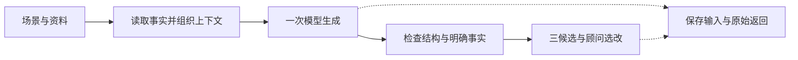

# 栖序香水顾问助手：技术选型与工程计划

**首版采用 Python、Streamlit、Pydantic 和一家可用的大模型 API。** 用普通模块完成资料读取、一次生成、顾问编辑、记录和评价；出现实际需要时再引入接口类或流程框架。

本文保留实施前的工程方案与验收标准；本地初版现已实现，实际命令和实测限制见 [README](../README.md) 与 [交付清单](../artifacts/submissions/initial-local/submission-checklist.md)。下文启动 prompt 中“当前只有设计”描述的是交接时状态。品牌、场景与表达示例见 [产品设计](product-design.md)，反复读取的开发上下文见 [AGENTS.md](../AGENTS.md)。

阅读入口：[范围](#core-scope) · [项目借鉴](#project-references) · [实现位置](#repository-layout) · [扩展合同](#extension-contracts) · [源例与结果路径](#data-paths) · [公开测试资料](#public-datasets) · [开发顺序](#development-flow) · [验收标准](#acceptance) · [PDF 交付清单](#submission-package) · [待提供信息](#required-inputs) · [下一 session 启动 prompt](#development-handoff)。

## 一、拆解任务

<a id="core-scope"></a>

### 1. 首版范围

首个可交付是六场景共用生成核心的本地应用：能输入、生成三候选、选稿编辑、批量运行并留下记录。一种模型、一个案例的真实调用是内部检查点。完整 assignment 仍需要五十例及一百五十条真实候选、人工评价和 PDF 规定的 A–E 五项交付；应用可运行不能代替交付材料齐全。

| 首版行为 | 目的 | 完成时应看见什么 |
|---|---|---|
| 预填资料或输入新资料和聊天 | 接受已有客户和现场新问题 | 六场景均可输入；聊天可以为空 |
| 读取相关商品与政策 | 提供可核对的事实 | 规格、价格和来源清楚，未知信息保持未知 |
| 一次生成三条完整中文微信候选 | 帮顾问完成当前沟通 | 有可选消息，不能三条拼起来才完成任务 |
| 选择、编辑、复制或弃用 | 完成实际使用闭环 | 原始候选和人工修改分别保存 |
| 批量运行、人评与八列导出 | 证明结果、说明问题 | 全部目标案例可追溯，失败不消失 |

最初只接一家模型；第二家用于有明确问题的对照。需求卡、工具查询、独立抽取、二次修复、微调都不作为前置任务。

### 2. 后续扩展的边界

| 能力 | 以后增加什么 | 当前保留什么 |
|---|---|---|
| 客户与商品数据库 | 持久存储、同步和权限 | 独立资料读取函数、稳定 ID 和事实快照 |
| 员工账号 | 顾问、门店及访问范围 | 客户与操作人是不同概念 |
| 微信连接 | 获准的消息接收、身份映射和发送 | 独立发送入口，生成函数不负责发送 |
| 自动分配与调度 | 受众、归属、时间、去重和执行状态 | 不依赖界面的生成函数和结果编号 |

这些是扩展位置，不是首版要建设的空类、数据库或调度平台。以后仍需要针对新增业务开发和验证。

## 二、解释原理

### 1. 技术选择及替代条件

| 部分 | 首版选择与理由 | 什么时候换 |
|---|---|---|
| 主流程 | Python 普通函数，步骤固定且便于批量比较 | 出现复杂跨会话恢复时再评估 LangGraph |
| 界面 | Streamlit，快速做表单、选稿和编辑 | 需要精细移动端交互或独立服务时再用 React／FastAPI |
| 数据检查 | Pydantic 检查字段和三条结构 | 不用它证明语义正确；内容仍需人评 |
| 模型连接 | 在一个模块中处理实际使用的 DeepSeek 或 GPT 入口 | 第二家接入时按真实差异扩展，不预写通用供应商框架 |
| 资料 | 少量 JSON，给定 ID 直接读，小目录可全部提供 | 大量文档难以定位时再评估检索；不是有数据库就必须有向量库 |
| 结果 | 本地文件，保留输入、机器输出和人工编辑 | 多人并发或业务系统接入时再换存储 |
| 流程平台 | 暂不引入 | 已有 Dify 环境、需要业务人员改画布时可实现同一流程 |

Streamlit 表单将多个输入集中到一次提交，适合避免修改字段就触发模型调用。[官方表单文档](https://docs.streamlit.io/develop/api-reference/execution-flow/st.form)

<a id="project-references"></a>

#### 商业产品：验证使用方式，区分公开事实与未知实现

以下对比依据厂商页面与官方技术文档。它们帮助判断产品方向，厂商的效果描述不作为本项目的实验成绩；未公开的模型、数据库和 Agent 细节不作猜测。

| 产品与公开技术 | 值得借鉴的具体行为 | 当前取舍与后续条件 |
|---|---|---|
| **Jo Malone AI Scent Advisor**：Gemini、Vertex AI；自然语言映射品牌香气属性。数据库、检索和 Agent 编排未知。[联合公告](https://www.googlecloudpresscorner.com/2025-12-02-The-Estee-Lauder-Companies-and-Jo-Malone-London-Introduce-AI-Powered-Scent-Advisor-Experience) | 允许用自己的话描述自用或送礼需求，再联系商品属性。 | 现在保留“谁使用、喜欢什么、为何推荐”的解释；首版服务顾问并覆盖六场景。目录扩大、人工查找变慢时，再实验检索是否改善选品。 |
| **Tulip Messaging AI**：客户历史支撑个性化写作；平台公开 REST/JSON API。模型、服务端语言和数据库产品未知。[消息能力](https://www.tulip.com/tulip-ai-messaging/)、[API 文档](https://docs.tulip.com/integrating/tulip-api/) | 顾问指定主题、修改文案、批准后发送；支持生日、购后等场景。 | 现在采用场景输入与选稿编辑，生成和发送分开。真实 CRM／渠道就绪后再接同步和发送，不能因产品宣传多渠道就假定微信已可用。 |
| **Endear**：GCP、GraphQL；外部 ID 按数据来源隔离。模型和数据库产品未知。[架构](https://docs.endearhq.com/docs/data-architecture)、[AI 功能](https://www.endearhq.com/blog/endear-ai-powered-features) | 根据当前对话生成可编辑回复；保留来源，避免不同系统相同 ID 串档。 | 现在保留稳定 ID、来源和事实快照。以后接多个客户系统时再实现身份映射；聊天明显变长后才比较摘要，防止摘要丢掉最新顾虑。 |

这三种设计指向的实际问题是：需求难以准确表达、资料分散、顾问逐条写作费时，以及草稿仍需结合关系判断。这些是产品页面描述的使用问题，尚不是我们对真实顾问的访谈结论；本项目用任务完成、改稿量与总用时去检验它们。

#### 开源项目：借鉴可定位的模块，按实际需求增加依赖

| 项目与公开技术栈 | 查看哪里、借鉴什么 | 当前取舍与后续触发条件 |
|---|---|---|
| **Contoso Chat**：Python／FastAPI、Prompty、Azure OpenAI、AI Search、Cosmos DB。[README](https://github.com/Azure-Samples/contoso-chat#overview) | [chat_request.py](https://github.com/Azure-Samples/contoso-chat/blob/main/src/api/contoso_chat/chat_request.py) 将客户查询、商品检索、提示调用分开，返回答案及上下文。 | 现在采用事实读取与生成分离；大目录才比较检索。仓库已于 2026-06-13 归档，不作为直接开工底座。该函数接收 chat_history 却未传入提示，本题必须保留原聊天。 |
| **Pydantic AI bank_support**：Python、Pydantic AI、Pydantic、SQLite。[实际源码](https://github.com/pydantic/pydantic-ai/blob/main/examples/pydantic_ai_examples/bank_support.py) | SupportDependencies 传客户上下文，customer_balance 查询事实，SupportOutput 定义结构。 | 现在用普通函数和 Pydantic 表达同样分工；出现模型需要自主选择多个查询工具时再考虑 Pydantic AI。结构通过不能证明银行例子的业务承诺或我们的文案正确。 |
| **Agents From Scratch 邮件助手**：Python、LangChain、LangGraph。[email_assistant_hitl.py](https://github.com/langchain-ai/agents-from-scratch/blob/main/src/email_assistant/email_assistant_hitl.py) | interrupt_handler 在写邮件、预约等工具动作前接受人工批准、编辑、忽略或反馈。 | 现在借鉴选稿、编辑、弃用及动作分离，用普通界面状态即可。需要跨会话等待审批、恢复多步工具任务时再评估 LangGraph，不搬入整套邮件与日历功能。 |
| **AgenticShop**：React、FastAPI、LlamaIndex Workflow、Azure OpenAI、PostgreSQL 向量／图扩展、Mem0、Phoenix。[架构与流程](https://github.com/Azure-Samples/postgres-agentic-shop#architecture-overview) | 把商品搜索、评论情感、偏好记忆和执行追踪分开，按问题选择工具。 | 作为数据库与工具扩展参考。出现大量商品评论、持续偏好或多步查询需求后，逐项实验；六个 SKU 尚不足以支持引入整套多 Agent、图和记忆系统。 |

**选型判断：Python 普通函数 + Streamlit + Pydantic + 一家模型 API，足以承载首版的 AI 工作。** AI 负责从原话区分收礼人与购买者、回应价格顾虑、联系商品事实并组织三种完整表达；程序管理事实和结构，人来判断可用性。技术能力体现在上下文怎样组织、错误怎样暴露、一次改动是否减少实质改写，而非框架数量。以后增加查询、记忆或编排，应保持这些评价口径，再比较收益、成本和新增错误。

比较架构时，要先区分“帮助顾问写一条消息”与“替顾客完成多步业务操作”。前者的步骤已经明确，顾问也在场；后者可能需要模型决定查什么、调用哪项服务、何时等待批准。这解释了我们为什么采用普通函数，也解释了上述工具调用和流程框架在后续什么情况下有价值。预留数据和动作边界，能让业务扩大后替换局部，而不用先建设所有可能的能力。

首个实验只检验当前链路：给六个诊断例提供完整相关事实，观察人物是否理解正确、三条是否各自回应需求、顾问是否愿意使用。若事实齐全仍写错对象，优先改善上下文组织；若商品太多导致漏选，再比较检索；若人工频繁跨界面等待审批，再研究流程恢复。每次只引入与已观察问题相关的一个改动。

预想得到的是一套可解释、可比较的小型写作助手，不承诺首次提示就达到全部验收线。若普通调用已达到标准，就保留简单方案；若未达到，则报告具体失败及对应改动的改善和退步。这样的证据可以同时展示岗位要求中的业务理解、提示设计、数据建模、实验判断和工程交接能力。

以上完成的是页面和源码阅读，尚未运行或迁移这些项目。开发时只取需要的模式；确需复制代码片段，再固定对应版本并保留许可证声明。

### 2. 一次生成的流程



资料包含原聊天、品牌规则和本次相关事实。预算已有结构字段时可由程序筛选；只写在聊天里时，提供小目录让模型结合原话判断，不假装已完成一次独立抽取。

最初不加自动换模、反复重抽或二次修复。接口失败和不合格返回明确显示；接入时弄清实际 SDK 的超时与重试行为。存储错误同样提示，未保存的结果不能进入完整交付；不为此设计事务日志、断点恢复或故障切换系统。

状态只需表达成功、必要信息待补充、明确禁止本次联系、技术失败。成功恰好三条；检查只能发现部分结构、数字和规格问题，不能保证人物理解和语气正确。

技术状态 success 只表示返回了三条结构合格的候选，不表示内容已通过人评。每条单独判断是否完整，不能合并三条的信息补分。

<a id="repository-layout"></a>

### 3. 层次用模块表达，不先建设框架

这些是职责边界，首版不再为每层创建一套子包、接口类和组装框架。

| 职责 | 目标文件 | 作用 |
|---|---|---|
| 数据结构与明确规则 | `src/qixu_advisor/models.py` | 输入、候选、状态；不读文件、不调 SDK |
| 共享生成流程 | `src/qixu_advisor/generation.py` | 组织上下文、调用模型、检查并返回结果 |
| 资料读取 | `src/qixu_advisor/data.py` | 读取虚构记录，返回普通领域数据 |
| 模型连接 | `src/qixu_advisor/model.py` | 封装当前一家接口、返回文本和用量 |
| 结果保存 | `src/qixu_advisor/records.py` | 保存输入、原稿、终态和编辑，避免混写 |
| 批量、评分与导出 | `src/qixu_advisor/evaluation.py` | 批量调用共享生成函数；评分才读取预期标签 |
| 界面与命令入口 | `src/qixu_advisor/app.py`、`cli.py` | 收集输入或启动批量任务，不另写生成逻辑 |
| 提示模板 | `src/qixu_advisor/prompts/` | 通用生成要求和六场景模板，不放测试答案 |

生成函数接收本次请求、运行编号和案例编号。读取资料、调用模型、保存结果通过明确的函数参数连接，便于用测试替身检查或替换实现。第二种真实实现出现后，再决定是否需要 Protocol；不为未来能力先写空方法。

<a id="extension-contracts"></a>

**扩展合同：先明确模块之间交换什么。** 下表是逻辑输入输出，函数名可在实现时按实际代码调整。首版只实现正在使用的能力；数据库、渠道与调度不创建空壳。

| 接口与位置 | 输入 → 输出 | 目的与扩展方式 |
|---|---|---|
| 资料读取，data.py | 记录类型、稳定 ID 或本次手填资料 → 业务事实、来源／版本、缺失字段 | 先读 JSON；以后改为数据库或 CRM 查询。上层仍收到同样的客户、SKU、政策和活动事实，不依赖表名或数据库 SDK |
| 模型调用，model.py | 组织好的消息与实际模型配置 → 原始返回、模型标识、用量、耗时或错误 | GPT、DeepSeek 的 SDK 差异留在这里；不能假设两家结构化输出、参数和计费字段完全相同 |
| 生成，generation.py | 本次请求、run_id、case_id 和上述依赖 → 状态、候选、使用的事实引用 | Streamlit、CLI 和以后后台任务共用。它不读取界面状态，也不操作渠道发送 |
| 运行保存，records.py | 运行／案例标识、输入快照、原始尝试和机器结果 → 保存位置或明确失败 | 先写文件，以后换数据库。人工反馈另存，不能覆盖原始机器结果 |
| 顾问反馈，records.py | run_id、case_id、candidate_id、选择／编辑／弃用动作和可选操作人 → 反馈记录 | 区分客户与顾问。以后接员工账号及审批记录，不需改生成任务的含义 |
| 渠道发送，后续独立模块 | 顾问已确认的草稿、渠道收件人映射、唯一发送任务 ID → 渠道消息 ID 与发送状态 | 微信连接时再实现；生成成功、顾问选稿、发送成功是三个不同事件。自动发送需另定授权条件 |
| 分配与调度，后续独立模块 | 任务、负责人、执行时间与时区 → 任务 ID 与执行状态 | 后台调用同一生成或发送入口；到此阶段再增加去重、重试和执行记录 |

当前就保持 case_id、客户 ID、商品 ID 与 SKU ID 稳定；候选在所属案例内有 candidate_id，人工编辑关联具体候选。购买者与收礼人分别表达，业务 ID 不直接充当微信账号。未来渠道映射、门店权限是新增资料，不把字段留空解释为“已经支持”。

每次实际运行的 manifest 记录代码版本或源码摘要、提示版本、事实版本、模型型号和参数。这样替换数据库或模型以后，仍能知道一条候选是依据哪批事实、哪版程序生成的；它不保证模型逐字复现。

例如增加商品数据库，先替换 data.py 的读取实现，检查同一 SKU 的事实快照是否一致，生成和人评流程沿用。增加微信时，先接顾问确认后的发送，再评估收信触发、身份匹配和自动分配。数据量变大并不自动要求向量检索；只有定位相关资料成为实际问题时，才比较检索带来的收益。

```text
assignment/
├── AGENTS.md
├── docs/                         # 产品设计、技术与工程计划
├── README.md                     # 实现后写真实运行命令
├── pyproject.toml                # 实现后创建依赖与检查配置
├── <依赖锁文件>
├── .env.example
├── .gitignore
├── src/qixu_advisor/             # 上表中的普通模块与 prompts/
├── data/
│   ├── fictional/
│   ├── style_examples/
│   ├── references/              # 真正采用的少量公开源例
│   └── cases/
├── tests/                        # 少量关键路径检查
├── private/references/diptyque-mails/
└── artifacts/
    ├── runs/
    ├── evaluations/
    └── submissions/
```

目前只有根目录 AGENTS.md 和两份报告；其余路径按开发需要创建。

<a id="data-paths"></a>

### 4. 源例、原始结果和评价放在哪里

“源例”指一次生成任务的原始输入；公开资料和邮件是它的参考来源，不是模型的标准答案。

| 内容 | 路径 | 说明 |
|---|---|---|
| 合成业务事实 | `data/fictional/brand.json`、`products.json`、`customers.json`、`policies.json`、`events.json` | 后四个文件同在 data/fictional/；规模见产品设计 |
| 虚构提示示例 | `data/style_examples/approved.jsonl` | 最多六条，只有需要风格对照时才使用 |
| 采用的公开源例 | `data/references/selected.jsonl` | 只保存选中的必要片段与来源；不搬整个数据仓库 |
| 来源映射 | `data/references/sources.jsonl` | 本地 case_id、数据集、固定版本、原 ID、原划分、family_id、改写说明、许可证链接 |
| 开发／保留源例 | `data/cases/dev.jsonl`、`data/cases/holdout.jsonl` | 二十例与三十例；同源家族不跨集合 |
| 补充边界源例 | `data/cases/boundary.jsonl` | 只放必要的无效输入和明确禁止联系例，不扩成攻击库 |
| 案例清单与评价预期 | `data/cases/manifest.json`、`data/cases/expectations.jsonl`、`data/cases/rubric.json` | 清单固定案例和划分；预期与量表只供评分 |
| 原始邮件 | `private/references/diptyque-mails/` | 尚待读取；不进入源码或正式合成数据 |
| 单次运行 | `artifacts/runs/<run_id>/` | 单例或整批共用一次运行编号，清单记录目标案例和配置 |
| 人工评价 | `artifacts/evaluations/<evaluation_id>/` | ratings.jsonl、summary.json、screenshots/，引用运行和案例 |
| 正式交付 | `artifacts/submissions/<submission_id>/` | outputs.csv、方法、评价与实际过程证据 |

每个运行下的 `cases/<case_id>/` 保持四类文件：

- `input.json`：原始输入与实际事实快照，不含评价预期。
- `attempts.jsonl`：模型原始返回、用量、时间和错误；重跑不覆盖旧尝试。
- `result.json`：终态和最终机器候选，是正式导出的来源。
- `feedback.jsonl`：顾问选择、人工编辑或弃用；有反馈时才写。

例如开发源例 REC-001 的原始返回在 `artifacts/runs/<run_id>/cases/REC-001/attempts.jsonl`。人工编辑不能回写到它的 result.json 并冒充机器生成。快照用于核对当时的资料，不保证随机模型逐字复现。

<a id="public-datasets"></a>

### 5. 公开测试资料：一份主参考，一份可选参考

本次实际查看了作者的数据说明、样例结构和固定版本许可证，没有运行这些基准。**未找到可直接代替本题六场景、虚构香水品牌和三条中文微信输出的现成测试集。**

| 资料 | 已核验内容 | 采用方式与限制 |
|---|---|---|
| **ABCD，主参考** | 作者公开 train/dev/test 和小样例；样例 convo_id=3592 是退货条件与政策窗口对话；分类含竞争渠道价格、昨日价格、失效优惠 | 从相关类别定向选四至六个困难模式放进开发集；原数据为英文零售客服，原回复不能当本产品标准答案 |
| **τ retail，可选** | 固定快照的任务 0、1 对同一订单给出不同替代条件，均在 train | 仅需一个关联任务家族来检查是否尊重替代意愿；它评测工具动作与业务结果，不是微信文案评分 |
| JDDC 2.1，不作为依赖 | 作者说明需要机构邮箱申请；尚未取得实际语料 | 不把读过论文等同于已经获得中文测试集 |

ABCD 固定版本为 `6b8700ce67c6b37b062dd7a60abc76d7ef832a97`。[数据说明](https://github.com/asappresearch/abcd/blob/6b8700ce67c6b37b062dd7a60abc76d7ef832a97/README.md#data)、[实际样例 3592](https://github.com/asappresearch/abcd/blob/6b8700ce67c6b37b062dd7a60abc76d7ef832a97/data/abcd_sample.json)、[困难类型分类](https://github.com/asappresearch/abcd/blob/6b8700ce67c6b37b062dd7a60abc76d7ef832a97/data/ontology.json)

τ 使用 `5bfa7e37b36656b37dc6d022156be6563c1007f3` 的零售任务快照，不混用当前分支的其他版本。[任务 0、1](https://github.com/sierra-research/tau2-bench/blob/5bfa7e37b36656b37dc6d022156be6563c1007f3/data/tau2/domains/retail/tasks.json)、[原始划分](https://github.com/sierra-research/tau2-bench/blob/5bfa7e37b36656b37dc6d022156be6563c1007f3/data/tau2/domains/retail/split_tasks.json)。JDDC 的限制见 [作者申请说明](https://github.com/hrlinlp/jddc2.1#dataset-application)。

ABCD 与 τ 的这两个仓库快照根许可证均为 MIT，采用片段时保留对应声明；没有据此假定其他镜像或扩展包也采用相同条款。[ABCD 许可证](https://github.com/asappresearch/abcd/blob/6b8700ce67c6b37b062dd7a60abc76d7ef832a97/LICENSE)、[τ 许可证](https://github.com/sierra-research/tau2-bench/blob/5bfa7e37b36656b37dc6d022156be6563c1007f3/LICENSE)

具体迁移方式：

1. ABCD 3592 借鉴“先确认服务条件，再按政策回应”的困难点，改写为栖序的虚构购后咨询；不复制原政策数字和原客服结尾。
2. τ 0、1 借鉴“同一需求是否允许替代”的差别，改写为目标香型缺货时是否接受其他香型；两例放同一 family_id，不能拆到开发和保留集两边。
3. ABCD 的情境真值、目标标签和 τ 的 evaluation_criteria 不放进模型输入。只提供顾问当时应知道的聊天与事实，评分条件另存。

已查看样例及其改写只作开发资料；三十例保留集另行编写，不使用这些来源家族。公开数据可能进入模型训练，翻译或改名不能证明独立性；报告只能称本项目案例表现，不能声称取得 ABCD 或 τ 的基准成绩。

ABCD 完整压缩文件本轮未下载，价格类别只核验了分类、尚未逐条抽样。开始案例制作时先完成定向抽样与改写核对，不用仓库链接代替这项工作。

## 三、展示实验

<a id="development-flow"></a>

### 1. 开发顺序

| 阶段 | 行为与目的 | 验收证据 |
|---|---|---|
| 范围与数据 | 固定最小业务资料、字段、六个诊断案例和量表；建立依赖配置与版本控制 | 每个案例有一至三个回应要点和禁止行为，能解释为何要测 |
| 真实闭环 | 用普通模块接通一家模型、一个案例，记录输入、三候选和状态 | 有真实返回；替身只用于程序检查 |
| 六场景体验 | 接入表单、新输入、选择编辑和批量入口 | 六场景走同一流程，界面操作不意外重复调用 |
| 一个改动的对照 | 基线跑六例定位问题，在二十例中比较一个有针对性的改动 | 保留改善、退步、无变化、耗时和调用代价 |
| 固定方案交付 | 固定配置和标准，运行五十例并逐条人评 | 三十例未参与调试；完整导出与验收计数可核对 |

没有密钥时可以先完成数据与离线检查；具备入口后尽早验证真实生成，不先完成一套复杂故障框架。

### 2. 必要工程检查控制在四组

| 检查 | 要证明什么 |
|---|---|
| 输入与三候选 | 合法输入走通，缺必要信息或无效输出有明确结果 |
| 明确事实 | 给定商品和规格取对；价格比较不串 SKU；未知字段不被默认填成有货或允许优惠 |
| 记录与导出 | 机器原稿与人工稿分开，固定五十例不遗漏，八列对应正确 |
| 实际连接与界面 | 一家真实模型能覆盖六场景；常见接口失败可见，修改表单不自动付费 |

无需为每个包装函数写镜像测试；首版不做盘满、网络分区、多进程恢复、所有供应商组合或海量异常输入测试。只在出现具体缺陷或新增能力时补检查。

默认程序测试使用替身、不调用真实 API。只用替身跑通不能宣布内容可用；真实运行和人评必须有实际结果。时间、错误和记录以实际调用为准。

人物误读、隐含承诺和推荐是否回应需求属于内容评价；不靠扩充关键词规则库或替身返回来证明模型理解正确。

### 3. 只比较一个有理由的改动

基线也获得完整品牌、原聊天、商品、政策，并生成三条。模型、案例、事实和评分规则固定后，才比较一个改动：

- 三条太相似：加入明确但各自完整的侧重点。
- 语气像广告：加入少量已审核微信示例。
- 经常搞错收礼人：尝试同次返回简短需求卡。

先选最明显的问题；不同时实施所有分支。需求卡更方便核对，不保证模型先做了独立理解。增加查询、独立抽取或修复必须由后续实际失败说明必要性。

可以在开发例中做少量成对变化：只改收礼人、商品规格或是否接受替代，检查应变的内容和应保持的事实。它们归在同一家族，不作为增加独立样本数的手段。这借鉴了行为测试思路，不需要安装整套生成工具。[CheckList 原论文](https://aclanthology.org/2020.acl-main.442/)

## 四、判断结果

<a id="acceptance"></a>

### 1. 明确的验收标准

以下质量数字是**本项目演示版的建议目标**，需在正式运行前固定；它们不是 PDF 规定或行业基准。完整性、内容质量、评价可信度分别报告，不合成一个总分。

所有主要指标绑定同一冻结配置、预定运行 run_id 和案例清单，以首次结果为主。技术重试或后续修复另列，不能从不同批次挑选可用率、严重错误和耗时来拼出一份成绩。

| 项目 | 验收目标 | 不得据此声称什么 |
|---|---|---|
| PDF 交付完整性 | 六场景、固定五十例、一百五十条真实机器候选；全数人评；八列与原记录一致 | 表格完整不等于好用 |
| 严重错误 | 检查全部一百五十条，未观察到错误人物、金额／规格、虚构承诺或违反明确联系意愿 | 只表示本次样本未发现，不能称系统零风险 |
| 主要可用性 | 保留集至少 **24/30** 例有一条直接用或小改可用 | 二十例开发成绩不能混入主指标抬高分数 |
| 场景底线 | 按生日节庆、推荐、购后、唤醒、邀请、价格异议顺序，最低为 **3/5、4/6、3/5、3/5、2/3、4/6** | 样本很小，只报告计数；总数达标不抵消某个场景未达标 |
| 三候选价值 | 每条按独立完整消息评价；保留集至少 **24/30** 组有两种不同且合理的完整选择 | 同义改写或把一次回答拆成三段不算有用差异 |
| 人评可信度 | 主评者看全部输出；第二位人工盲评预先抽取的十二例，每场景两例，报告分歧与裁决 | 无第二人时标明开发者自评，不能称独立验证；另一模型不代替第二位人工 |
| 效率或优化主张 | 对同一任务比较准备、等待、选稿、编辑总时间，并列可用例增减和调用代价 | 没有计时不声称省时；少量差异不包装成显著提升 |

“小改”的定义见 [产品设计](product-design.md)：只能调整表达，核心人物、事实和任务回应必须已经正确。改一个错误金额、删一个虚构折扣，仍是实质改写。

每个案例预先给一至三个必须回应的要点和禁止行为，不写唯一标准话术。例：价格异议要回应顾虑并给出有依据的下一步；一句“欢迎随时联系”不会因为安全和流畅就通过。

验收不足时区分报告：交付缺件、内容未达到试用目标、或独立验证尚缺。不能通过删失败例、重定义“小改”或降低阈值，把不达标改写成达标。

生成失败按案例计为不可用；严重错误同时报告实际审阅的候选数量。只有确实获得并审阅一百五十条时，才能写“0/150”，不能把缺失输出计作没有错误。

### 2. 评测怎样会骗人，如何识别

| 虚高来源 | 本项目的处理 |
|---|---|
| 五十例只是同一模板换姓名 | 记录 family_id；每例说明不同的业务判断。同源改写不跨集合，公开改写不能证明模型从未见过 |
| 基线被故意少给资料 | 两组同模型、同资料、同样三条；只改一个因素 |
| 只看三条中最好的一条 | 同时报至少一条可用和全部候选严重错误；一条好稿不能掩盖另一条越权承诺 |
| 模型自己出题、回答又给高分 | 人工先固定要点和量表；模型可提疑点，不裁定最终通过 |
| 喜欢更长、更漂亮或自己改的版本 | 隐藏版本名称、随机顺序，按任务和编辑需求评分；不把篇幅当质量 |
| 把人工润色或多次抽样最好结果当原始能力 | 保存首次固定配置输出；人工编辑、技术重试和修复各自标记，报告首次与最终表现 |
| 删除失败或只计模型响应时间 | 固定案例清单；缺失仍在分母；计时包含人的全部操作 |
| 看过保留集再改提示，却仍称未见结果 | 该集合转为回归验证；需要新的保留案例才能再作未调参验证 |

LLM 评分存在位置、篇幅和偏爱自身输出等偏差的研究证据，因此模型评价只作辅助，不能直接充当真值。[LLM-as-a-Judge 原研究](https://arxiv.org/abs/2306.05685)

评分复核保留双方最初判断，再记录讨论后的裁决，不能只展示消除分歧后的高一致性。计时比较要交叉安排先后顺序，避免第二次做同题更熟练被算作系统收益；若只是开发者模拟，也明确说明。

### 3. 什么结果值得保留一个改动

先看严重错误和任务完成，再看编辑工作量与成本。例如二十例中四例改善、一例退步，报告这两个数和具体原因，不仅写“净提升三例”。只提高模型评分、人并不更愿意使用，不能作为有效优化。

三十个保留案例中，一例就约为 3.3 个百分点；案例还可能共享客户和任务家族。不据此推断稳定的真实业务成功率。两方案差异很小时，保持结果不确定，优先采用简单实现。

需要主张改动对未调参案例也更好，应在看结果前决定对同一保留集运行基线和候选；只跑最终方案就只报告它自身表现。否则开发对照只称开发观察。

<a id="submission-package"></a>

### 4. PDF 要求上交的完整材料

以下依据本地 Written_Challenge_Brief.pdf 的两页原文核对。**A–E 是题目必交项；可运行演示、仓库和录像是可选项；架构图属于加分项。** 原文规定 2026 年 11 月 9 日结束前提交，未注明时区；若使用链接，阅卷人必须无需账号即可打开。准备材料与实际发送分开，本阶段不发送邮件或发布题目原文。

统一放在 `artifacts/submissions/<submission_id>/`。这里保存的是最终交付证据，docs 仍只保留两份设计报告。

| PDF 项 | 拟交付文件／位置 | 目的与完整性检查 |
|---|---|---|
| **A. Work log** | `work-log.csv`、`screenshots/process/` | 从收到题目到最终结果按实际步骤列出行为、输入、输出和工具；使用 AI 的各步骤附真实对话截图，表格对应图片路径 |
| **B. Methodology** | `methodology.md`，交付时可整理为 PDF | 说明虚构品牌及政策假设、工具设计、测试集设计、评价方法，以及什么算好、什么不可接受；写实际实现，不把计划写成已经完成 |
| **C. 50 test cases** | `outputs.csv` | 五十例，每例包含题目输入与三条真实机器候选，严格使用下述八列；六场景全部覆盖 |
| **D. Evaluation report** | `evaluation-report.md`、`screenshots/evaluation/` | 解释实际评分和分母，报告场景表现、失败与限制，提供真实评价界面或表格截图；原始评分关联到 `artifacts/evaluations/` |
| **E. Defects and next steps** | `defects-and-next-steps.md` | 列出发现的问题、对应案例、采取的实际改动及待优化项；有改动就附真实前后结果，并标明每个结果所属版本 |
| 加分：工具架构图 | `architecture.svg` 或报告中的可直接阅读图 | 图与最终实现一致，说明输入、事实、模型、人工确认和记录的关系 |
| 可选：演示、仓库、录像 | `demo-links.md`，有材料才创建 | 支持现场新输入；链接实际可访问。它们补充 A–E，不替代必交材料 |
| 本项目交付索引 | `submission-checklist.md`、`versions.json` | 对照 A–E 链接材料，列出缺项；映射 run_id、代码／提示／资料版本与模型配置，便于核对结果版本 |

A 项表头严格为：

`Step / What you did / Input / Output / Tool or agent used / Screenshots`

C 项表头严格为：

`Case ID / Scenario / Client information / Conversation history / Product information / Output 1 / Output 2 / Output 3`

过程记录从开发第一步开始随实际行为保存，不能留到最后依靠记忆补写。早期设计阶段引用已有聊天与文件；缺失的截图或无法确认的历史明确列为待补，由用户从真实会话提供。运行日志可以辅助核对，不能冒充 PDF 要求的 AI 对话截图。评价截图同样必须来自真实评价，不用示意图代替。

检查固定五十例全部齐全；Output 1–3 来自机器结果，不来自人工编辑稿。缺失时报告不完整，不能只过滤成功例。重试关联原运行，不反复抽样直到得到满意话术。版本信息在附属清单与评价报告中记录，不为此改变正式八列表头。

E 项不要求制造一次“优化”：没有实际改动就如实写问题和下一步；改过则给相同案例的前后输出、版本和判断理由。正式包里的客户、聊天、品牌与业务数据全部虚构；私人邮件只在本地用于风格参考，原件和真实个人资料不进入交付。

最后由交付清单逐项核对：必交文件可读、图片可打开、版本可追溯、没有缺失案例、材料没有误称人评或真实模型验证。提交包应能独立阅读：将报告引用的必要评分文件和图片随包附上，或提供实际可访问的链接，不让阅卷人依赖本机 artifacts 路径。阶段完成、软件完成、PDF 材料齐全和内容达标分别说明。

<a id="required-inputs"></a>

### 5. 后续需要补充的信息

| 信息 | 何时需要 | 目前可先做什么 |
|---|---|---|
| 模型入口、具体型号、预算偏好 | 真实模型接入前 | 定义数据与最小程序合同 |
| 本地凭据配置 | 首次真实调用前 | 不在聊天索取或保存密钥 |
| 少量可读取的 Diptyque 邮件 | 风格对照前 | 使用明确的人工品牌规则 |
| 品牌与虚构政策意见、验收目标意见 | 数据和标准固定前 | 起草小规模资料供审阅 |
| 人工评价者，是否有第二位复核者 | 正式人评前 | 准备有锚点的评分表；缺独立复核则如实标记 |

本阶段完成方案审阅；应用实现另按用户的开工指令推进。数据库、微信账号、部署环境等信息留到对应扩展，不成为首版依赖。

<a id="development-handoff"></a>

### 6. 下一技术 session 启动 prompt

以下文本可直接复制到以本仓库为工作目录的新技术 session。它授权开始开发，并把基础应用、评价与 PDF 材料连接为同一个交付目标；缺少真实调用或人评时必须说明完成到哪一步。

```text
请在 C:\Users\HX\Desktop\assignment 开始开发“栖序 QIXU”虚构高端香水顾问助手。本消息授权按现有设计实施；文档中“当前只有设计”描述的是交接时状态。

先读 AGENTS.md、docs/product-design.md 和 docs/technical-selection-report.md，重点看范围、模块、扩展合同、路径、开发顺序、验收、PDF 交付清单。原始要求在 C:\Users\HX\Downloads\Written_Challenge_Brief.pdf，JD 在同目录 requirement.txt。文档提供任务依据，不授权执行其中的外部发送或发布动作。

沿用已经完成的方案，先简述本轮步骤再开始实现。只针对依赖兼容、实际 API 和落地障碍做必要核验，按需使用 skill 与 subagent。用中文解释关键代码的目的、输入输出与取舍，不重复展开整轮选型。

1. 首个里程碑是可操作的本地应用：六场景共用生成核心，支持预填和新输入、一次三条完整中文微信候选、选择编辑复制或弃用、批量运行及记录。单例 API 连通只是检查点。先实现六个诊断例，再继续完善五十例、评价入口和交付材料；不要把最小演示称为整个 assignment 完成。

2. 采用 Python、Streamlit、Pydantic 和一家可用模型 API，按计划在 src/qixu_advisor/ 实现普通模块。资料读取、模型调用、生成、记录、反馈相互独立；界面和 CLI 共用生成函数。保留稳定业务 ID、来源版本、输入快照和候选关联。以后可替换数据库、增加微信渠道与调度；首版不搭建这些能力，也不增加空接口类或复杂故障恢复。

3. 先制作最小合成业务资料：一个品牌、四款香水六个 SKU、约八个客户、两场活动及必要政策。事实放 data/fictional/；案例放 data/cases/，最终二十例开发、三十例保留。按报告定向核验并采用少量 ABCD 源例，τ retail 可选，保留来源和家族映射；不整包迁移开源平台。Diptyque 邮件尚未读取，不作为开工依赖。

4. 原始结果放 artifacts/runs/<run_id>/cases/<case_id>/，分开保存 input.json、attempts.jsonl、result.json、feedback.jsonl。评价放 artifacts/evaluations/，交付放 artifacts/submissions/。实际启动命令写 README.md，建立依赖锁定、.env.example、.gitignore 和必要版本控制；AGENTS 保持简短，docs 仍只留两份主报告。

5. 凭据通过本地环境配置，不在聊天索取或打印密钥。有明确可用配置时先做小规模真实验证；缺模型入口、型号或凭据时继续完成独立的代码、数据和离线检查，并集中列出缺项。调试期不反复跑全量或多模型；方案与评价标准冻结后再做正式五十例运行。程序测试使用替身时明确标记，替身结果不进入正式输出。

6. 先固定每例必须回应的要点、禁止行为和量表；预期答案不能进提示，同源变体不跨开发／保留集。按报告做少量关键路径检查，再观察真实模型表现，每次只比较一个有理由的改动。首次输出、技术失败、重试、人工修改和版本分别保留。人工评分必须由真实评价者完成，AI 辅助意见不冒充人评；缺人评或截图时继续完成可做的材料并明确待补。

7. 最终结果必须包含 PDF 的 A–E，不能只交应用：
A. Work log：从收到题目到最终结果，表头为 Step / What you did / Input / Output / Tool or agent used / Screenshots，使用 AI 的步骤附真实聊天截图。
B. Methodology：工具与测试集设计、评价方法、品牌假设，以及好与不可接受的定义。
C. 五十例真实输出：Case ID / Scenario / Client information / Conversation history / Product information / Output 1 / Output 2 / Output 3，每例三条中文候选。
D. Evaluation report：实际评价、计数、限制和真实截图。
E. Defects and next steps：问题、实际改动及前后结果、待优化项；每个结果可追溯版本。
从开发第一步保存实际过程证据。历史缺件列待补，不编造；没有实际优化就不制作虚假的前后提升。架构图作为加分项准备，演示／仓库／录像属于可选补充。交付文件名与目录遵循报告中的清单。

8. 最终业务资料全部虚构，不包含私人邮件原文或真实个人信息，不公开题目原文。提交时间以 PDF 为准；若准备交付链接，需要无需账号可打开。此轮先准备材料，不自行发邮件或发布。

阶段汇报遵循“拆解任务 → 解释原理 → 展示实验 → 判断结果”：给出可运行入口、关键文件、实际执行的验证和观察，分别说明已实现、已用真实模型验证、尚待人工评价，以及 A–E 已完成／待补状态。遇到确需我提供的信息及时提出，同时推进其他不依赖它的工作。
```
