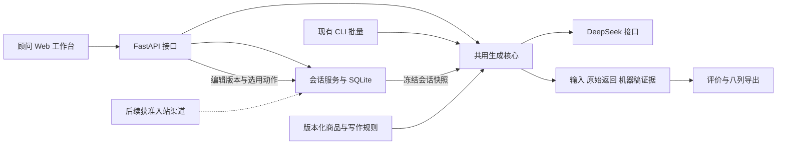

# 栖序 QIXU：技术选型与工程计划

更新：2026-11-07。**S0 方案已完成；S1 内容质量与写作设置已于 2026-11-07 实施并经真实诊断与 formal-v2 回归验证；S2–S5 尚未开始。** 本文是唯一技术计划，产品规则见 [产品设计](product-design.md)，实际命令见 [README](../README.md)，过程见 [WORK_LOG](../WORK_LOG.md)。读取本文不构成新一轮实施或发布授权。

入口：[范围](#core-scope) · [选型](#technical-decisions) · [架构／目录](#repository-layout) · [接口](#extension-contracts) · [数据](#data-paths) · [开发路线](#development-flow) · [验收](#acceptance) · [A–E](#submission-package) · [交接](#development-handoff)。历史自查和研究已集中归档，结论并入本文及产品报告，不继续维护平行计划。

## 一、拆解任务：范围、现状与依据

<a id="core-scope"></a>

### 1. 已有基础与下一版范围

现有 v1 是 Python／Streamlit 本地应用：六场景共用生成函数、三条中文候选、独立选稿编辑、代码框复制、批量、记录和评价入口均已实现。S1 已实施：写作规则包运行时加载（`prompts/writing_rules.md`）、四项写作设置（语言／语气／篇幅／目标）、生成后事实告警器（错字、规格、金额、未归属报价）。真实回归 `formal-v2` 为 50/50 成功、150 条；旧 `formal-v1` 49/50 与单例技术重试保留为回归基线。曾通过 68 项离线检查；这不是文案质量证明。真人评分仍为 0。

下一版按用户确认的顺序：**先修事实与写作，再做可恢复的独立 Web 工作台，最后验证企业微信／微信客服入站自动草稿。** 加入中英输入输出、目标／语气／篇幅设置、候选内编辑复制及有来源的偏好。保留六场景和每次三稿，正式 C 表仍全部中文。自动发送、订阅升级、完整 CRM、训练推荐模型不在此次路线。

自查已确认：历史商品未展开规范名，BD-103 写“青榄”、WAKE-103 写“青澜”；REC-103 将所选 SKU 子集表述得像完整规格；内部限制进入生日与购后消息；风格示例为空且生成器未读取；50 例没有客户→顾问→客户序列；记录落盘却无工作会话恢复入口。先针对这些证据修复，不以换界面代替质量改善。

<a id="project-references"></a>
<a id="public-datasets"></a>

### 2. 资料如何进入方案

公开品牌 FAQ／服务说明只借鉴答复结构，来源与规则见产品报告；未找到可验证的私人顾问聊天实录，私人邮件仍未读取。ABCD 已采用固定版本 `6b8700ce67c6b37b062dd7a60abc76d7ef832a97` 的四个 train 对话（3592、10287、8252、7132）改写开发例；片段、来源与许可证在 `data/references/`，不是尚待抽样，也不声称取得公开基准成绩。[作者数据说明](https://github.com/asappresearch/abcd/blob/6b8700ce67c6b37b062dd7a60abc76d7ef832a97/README.md#data)

PDF 是业务与交付依据；requirement.txt 是岗位背景，不要求为展示技术而引入 RAG 或多 Agent 运行框架。附件中的邮箱、操作文字与外部网页不构成发送、安装或发布授权。

## 二、解释原理：选型、架构、路径与接口

<a id="technical-decisions"></a>

### 1. 选型决策（官方资料于 2026-11-06 核验）

| 部分 | 下一版选择及理由 | 对比与替代条件／一手依据 |
| --- | --- | --- |
| 顾问界面 | React + TypeScript + Vite、普通 CSS；管理三稿编辑、会话与手机布局 | Streamlit 可以托管，迁移原因是交互需求。首期无 SEO／SSR，不引入 Next.js；先用 React 状态和 fetch。Vite 不代替类型检查，构建须含 `tsc`。[React](https://react.dev/learn/build-a-react-app-from-scratch)、[Vite](https://vite.dev/guide/features.html#typescript) |
| 服务入口 | FastAPI／Uvicorn 薄层，Pydantic 请求／响应；复用 Python 3.12 核心 | 现有 generate/httpx 同步，先用同步 `def` 路由；在 `async def` 直接调用普通同步函数不会自动转线程池。不重写生成器。[FastAPI 并发](https://fastapi.tiangolo.com/async/)、[请求模型](https://fastapi.tiangolo.com/tutorial/body/) |
| 会话存储 | 标准 `sqlite3`，单实例持久磁盘、短事务、显式 SQL | 表少，暂不加 SQLAlchemy；实际多实例并行写或持续锁冲突再评估 PostgreSQL，不能承诺只换连接地址。[Python sqlite3](https://docs.python.org/3.12/library/sqlite3.html)、[SQLite 适用范围](https://www.sqlite.org/whentouse.html) |
| 模型与结构 | 保留 httpx + 一家 DeepSeek；当前 deepseek-flash、关闭思考、JSON 输出 | 官方支持该型号与参数；仍检查空白、截断和业务结构。默认参数沿用现配置，语气由规则控制，不把温度当文风设置。[Chat Completions](https://api-docs.deepseek.com/api/create-chat-completion/)、[JSON Output](https://api-docs.deepseek.com/guides/json_mode/) |
| 事实与写作 | 版本化小 JSON 目录，运行时规则与审核示例，可解释偏好筛选 | 4 款／6 SKU 不需向量库或训练推荐模型。出现资料定位困难再做对照；安装开发 skill 不等于生成器已读取规则 |
| 记录与测试 | 文件证据、pytest、既有 Playwright；新增前端类型／构建检查 | DB 用于恢复工作，原始返回与机器稿继续独立留档；只补真实业务行为测试，不写包装函数镜像测试 |
| 运行形态 | 单台有持久盘的 Linux 主机，标准 Python 容器内一个服务进程；静态页面与 API 同源、HTTPS 反向代理 | 云服务商与域名在部署阶段确定。临时磁盘不承载业务库，不搭微服务或集群。[FastAPI 部署](https://fastapi.tiangolo.com/deployment/concepts/)、[容器](https://fastapi.tiangolo.com/deployment/docker/)、[持久卷](https://docs.docker.com/engine/storage/volumes/) |

Python 用现有 uv／uv.lock；前端用 Node／npm／package-lock.json。工程开始时解析兼容版本并固定实测工具链，验收用 `uv sync --locked`、`npm ci`、`tsc` 与构建。本轮不安装、不改依赖锁、不猜最新版本。密钥只在服务端，Vite 的 `VITE_` 变量会打进前端，禁止放密钥。[uv 锁定](https://docs.astral.sh/uv/concepts/projects/sync/)、[npm ci](https://docs.npmjs.com/cli/commands/npm-ci)、[Vite 环境变量](https://vite.dev/guide/env-and-mode.html)

Node 只用于开发／构建，`vite preview` 不作为生产服务。FastAPI 当前官方提供静态前端与 SPA 回退入口，工程锁版本时核验；API 优先，未知 `/api/*` 仍是 JSON 404，缺失脚本不能返回首页。现有模型超时 90 秒，代理等待须覆盖调用与保存开销，否则再改提交后查询模式。[Vite 部署](https://vite.dev/guide/static-deploy.html)、[FastAPI 前端](https://fastapi.tiangolo.com/tutorial/frontend/)

复制在点击回调读取当前编辑值，成功后才提示；不先等后端保存。HTTPS 与浏览器用户激活限制需实测。PWA 安装壳在 Web 稳定后增加，不带来离线模型或微信读取能力。[Clipboard](https://developer.mozilla.org/en-US/docs/Web/API/Clipboard_API#security_considerations)、[PWA](https://developer.mozilla.org/en-US/docs/Web/Progressive_web_apps/Guides/Making_PWAs_installable)

<a id="repository-layout"></a>

### 2. 目标架构与职责（新增部分待实施）



Web 会话快照与 CLI 显式输入进入同一核心，不另写生成逻辑；生成成功不代表人评通过或已发送。以下以 `src/qixu_advisor/` 为 Python 包根，计划路径只在需要时创建，不先建空壳。

| 路径 | 状态与单一职责 |
| --- | --- |
| `models.py` | 现有；增加写作设置和快照结构，旧输入默认中文兼容 |
| `generation.py`、`data.py`、`model.py` | 现有；生成、相关事实／身份装配、单供应商调用 |
| `records.py`、`evaluation.py`、`cli.py` | 现有；证据、批量／评价／严格导出、命令入口 |
| `app.py` | 现有 Streamlit 基线；新版交付前保留，不长期并行开发两套顾问 UI |
| `api.py`、`api_models.py` | 计划；HTTP 路由和传输模型，不自行读取提示或调用模型 |
| `conversations.py`、`storage.py` | 计划；会话业务、SQL 读写／迁移；网络调用不持有事务 |
| `preferences.py` | 计划；有来源的偏好确认／撤销、硬筛选与排序 |
| `prompts/writing_rules.md` | 计划；运行时规则，与现有 system.txt、scenarios.json 一起版本化；不是新增设计报告 |
| `migrations/001_initial.sql` | 计划；引入 DB 时创建，执行前备份、记录 schema 版本 |
| 项目 `web/src/` | 计划；api.ts 请求，features/conversations 会话，features/drafts 编辑复制，features/settings 设置；组件按需创建 |
| 项目 `tests/`、`tests/browser/` | 前者现有、后者计划；核心业务、API／存储与真实浏览器；测试生成显式替身 |

<a id="data-paths"></a>

### 3. 目录所有权与数据层次

| 位置 | 保存内容与清理规则 |
| --- | --- |
| `docs/` | 只保留产品、技术两份权威报告；后续研究与自查直接归入所属章节 |
| `README.md`、`AGENTS.md`、`WORK_LOG.md` | 阅读／操作入口、agent 约束、唯一日志；不重复整份方案 |
| `data/fictional/`、`data/style_examples/`、`data/references/` | 合成事实、审核示例、采用的公开源例与许可证；可提交 Git |
| `data/cases/` | dev 20／holdout 30／boundary 4、预期、量表、清单；新增语言／多轮另建源文件，不改旧冻结快照 |
| `runtime/qixu.sqlite3` | 计划工作库，工程时加入忽略；部署映射持久卷 |
| `artifacts/runs/`、`artifacts/evaluations/` | 运行／评分原始记录，保留来源与版本，不按缓存清理 |
| `artifacts/submissions/<id>/` | 各版 A–E 及证据集中保存；initial-local 冻结，不与主计划混写 |
| `artifacts/archives/` | 被替代的设计／研究按轮次打包，内含路径与 SHA；日常不再编辑 |
| `artifacts/backups/` | 本地完整恢复包；代码、证据和未来 DB 各说明备份范围 |
| `.cache/`、`.venv/`、未来 `web/node_modules/`／`web/dist/` | 可重建工作文件，确认无唯一证据后再清；private 与密钥始终不提交 |

逻辑表：customers、conversations、messages、preferences、generations、draft_revisions、draft_actions。消息保存作者、正文、时间、来源及外部 ID；会话保存本次对象／预算、设置、状态与递增版本。偏好记录主体、原文、明确／推测、确认／撤销状态；送礼需求不写成购买者偏好。收礼人是独立主体或该会话临时对象，不能默认属于购买者。

生成索引记录会话版本、请求键、run/case、状态与错误；草稿追加修订，不覆盖机器稿。近期原文与当前需求优先；长会话摘要必须关联消息和未确认事项。初始化仅导入尚不存在的合成客户，不覆盖编辑；Web 使用 DB 客户快照，data.py 不能用同 ID 旧 JSON 覆盖。连接在同一线程创建、使用、显式关闭，启用外键、参数绑定、有限锁等待；首期不额外调整 WAL。

每次运行仍分存 `cases/<case_id>/input.json`、`attempts.jsonl`、`result.json`，机器稿以不可覆盖文件为准。新版 Web 草稿修订／动作以数据库为真值，提交时按稳定 ID 导出 `feedback.jsonl` 快照，不在每次编辑时强制双写两处；旧 v1 追加反馈文件保持原样。输入包括设置、消息集合、事实范围与来源；代码、提示、审核示例、事实、模型参数／返回型号／用量版本可追溯。评分预期不进入提示。

**数据根须单独配置：**现有 root 同时控制源码／事实摘要和结果路径，不能直接指向空数据卷。计划 QIXU_RUNTIME_DIR 默认项目 runtime/，QIXU_ARTIFACTS_DIR 默认项目 artifacts/，部署映射持久卷；只读源码／合成目录根保持独立。旧 runs 不搬家，CLI 默认路径兼容。

<a id="extension-contracts"></a>

### 4. 接口与状态合同

内部仍用普通函数：data.load_facts(request) 返回有来源事实；generation.generate(request, run_id, case_id) 返回三稿或明确失败；model.call_model(messages, config) 返回原始文本／用量／耗时；records 留档。conversations 将保存的会话转成快照，storage 返回普通业务数据。真实第二种实现出现后再考虑 Protocol。

以下为待实现 `/api/v1` 合同；前端不直接读数据库或路径，工程时用 Pydantic 生成 OpenAPI，不另维护一份手写规格：

| 接口 | 主要输入 → 输出 | 关键约束 |
| --- | --- | --- |
| GET/POST /customers，GET/PATCH /customers/{id} | 查询／新档案／明确修改 → 客户与版本 | 资料足够可先生成，不强迫建完整档案；客户 ID 不是微信账号 |
| GET/POST /conversations，GET/PATCH /conversations/{id} | 客户、场景、需求、设置、product_ids、event_id、occasion、临时客户资料；修改带 expected_version → 会话、消息、草稿 | 版本递增；生成时一起冻结；关闭不删除原文 |
| POST /conversations/{id}/messages | role、content、source、时间、外部消息 ID → 消息与新版本 | source 区分手工／合成／渠道；外部 ID 在渠道及会话范围去重 |
| GET /catalog | 所选／历史 product_id 或 SKU → 名称、规格、价格、范围、来源 | 解析历史身份，子集不冒充完整目录 |
| POST /conversations/{id}/generations | expected_version、设置、Idempotency-Key → generation_id、状态、run/case、结果 | 服务端冻结输入；同键同内容返回原任务，同键不同内容 409；显式再生成用新键 |
| GET /generations/{id} | ID → 运行状态、三稿／缺项／错误、快照版本 | 刷新不重新付费；上下文变化标旧稿过时，不覆盖编辑 |
| PATCH /drafts/{id}，POST /drafts/{id}/actions | 正文＋expected_revision；selected/copied/discarded → 修订／动作 | 409 防止覆盖另一修订；copied 带实际 copied_text 和基准 revision，不等于 saved 或 sent |
| GET/POST /customers/{id}/preferences，PATCH /preferences/{id} | 带来源偏好候选、确认／撤销 → 状态与解释 | 区分使用者、临时条件与长期偏好；不从顾问选稿推断顾客喜好 |
| GET /settings/model | 无密钥输入 → configured、型号、公开参数 | 不返回密钥；初期服务端调整凭据，页面显示状态 |

写作设置固定为 `output_language: zh-CN|en`、`tone: natural|warm|direct`、`length: short|standard`、`goal: answer|recommend|next_step`。场景有默认值，设置纳入快照；候选固定三条，目标不能被语气或长度覆盖。

两层状态分开：任务 running/completed/interrupted；业务 success/needs_input/contact_blocked/technical_failure。初期 POST 同步返回终态，GET 用于恢复查询；重复的进行中请求返回同一 ID 与 running。首期最多一个活跃模型调用，超出返回 HTTP 429／busy，普通会话读写仍可执行，不引入队列平台。断线不自动重调；重启遗留任务标为 interrupted，保留 run/case，手动重试关联新运行。

幂等键以 `(conversation_id, Idempotency-Key)` 唯一约束保存。先按键查询，匹配首次请求内容即返回首次任务／快照，再对新键校验当前会话版本和繁忙状态；新任务原子占位，网络调用在事务外。这样客户继续聊天后重放同一请求也不会重复收费；新内容必须使用新键。请求内容摘要不随后来会话变化而重算成另一输入。

HTTP 200 仅表示已有记录，前端仍须判断业务 status；422 字段错误、404 不存在、409 版本／请求键冲突。无有效结果的 API 错误形如 `{error:{code,message,fields?},request_id}`，不返回栈、凭据或供应商原文。业务缺项／禁止联系保证零模型调用。技术失败保留原返回；空白、截断、非法结构不能自动修补或重抽。保存失败不能显示“已保存”。

草稿输入停顿后保存，一稿串行提交版本，显示保存中／失败；刷新仅承诺恢复已保存内容，未保存离开时提示，不以 localStorage 替代工作库。复制立即操作当前正文，再记录动作；候选响应只给必要正文、ID、版本和顾问警告，不暴露内部配置。

### 5. 入站渠道与部署边界

先人工粘贴／导入验证会话，再选一种获准渠道。入站接入器转成消息合同，然后触发快照生成；客户资料同步、微信客服消息、顾问存档分别核验。官方渠道页本次不可读，账号／权限／可取内容范围待复核，不能凭客户资料权限推断任意微信聊天读取。[客服入口](https://kf.weixin.qq.com/)、[消息文档](https://developer.work.weixin.qq.com/document/path/94670)、[存档入口](https://developer.work.weixin.qq.com/document/path/91770)

自动草稿阶段才建 draft_jobs.py 和实际接入器：合并短时间连续输入，按消息版本＋设置避免重复收费，新消息不覆盖人工编辑。偏好按预算／排除项硬筛选，再对确认属性等权匹配并解释，推测可确认／撤销；若抽取需要额外模型调用，单列费用和实验。当前不实现自动发送。

部署先验证持久卷、重启恢复和服务端配置。真实业务受控访问；公开提交用合成资料／只读材料入口满足免账号查看要求。平台和身份接入在部署阶段按实际条件确定，本轮不选云账号、不发布。

## 三、展示实验：开发路线与证据

<a id="development-flow"></a>

### 1. 分阶段推进

| 阶段与先决条件 | 开发内容 | 阶段出口与主要路径 |
| --- | --- | --- |
| S0 当前方案 | 选型、两份报告、接口／目录、自查与 PDF 映射 | 文档一致、可交接后汇报；本轮止于 S0，不因文档存在自动进入 S1 |
| S1 用户明确实施后：事实与写作 | 先历史身份／规格范围／预算误报，再写作包；增加语言等设置 | models/data/generation/prompts；离线后六开发例真实对照，事实与写作改动分开记录 | **已完成（2026-11-07）**：规则包与设置已实现，diagnostic-s1 六例成功，formal-v2 50/50 成功导出八列 C；告警器 9 条误报经修复后 50 例重放零告警，新冻结 formal-v3 |
| S2 合同稳定后：会话与 API | SQLite 迁移、客户／消息／临时需求、偏好、生成／草稿接口 | storage/conversations/preferences/api；恢复、人物隔离、冲突、一请求一调用 |
| S3 API 可检查后：工作台设计与工程 | 先桌面／手机流程草图并入产品报告，确认层级再 React 实现 | web/；原位编辑复制、保存状态、重开会话、手机布局；视觉在设计时确定 |
| S4 小规模检查后：质量与交付 | 六场景多轮、24 语言组；冻结后 50 例回归及约定人评；打包／检查脚本先支持新 submission_id、区分只读与写报告 | 新 runs/evaluations/submissions；首轮重试分开，旧包冻结；两份历史脚本均会改初版包，不直接重跑 |
| S5 工作台稳定后：部署／渠道 | 先单实例部署，官方权限与测试账号具备后接一种入站源 | 消息合同复用、自动草稿由顾问选用，不包含自动发送 |

主 session 管范围、集成与证据；可按文件所有权分派核心／存储、前端、数据／评价。Agent 共读两份权威报告，不各建平行计划；冲突回主 session。每阶段先明确输入输出与行为再写代码；过程追加唯一 WORK_LOG，检查后 Git 保存。质量原因未定位时不反复跑全量。

### 2. 实验与必要检查

先对 BD-103、WAKE-103、REC-103、PRICE-102 回归并新增同类输入；事实修复后固定输入与模型，用六场景开发例对比写作包。规则与示例同时改只能判断整包效果，区分贡献时才单因素比较。原始失败不得被满意重抽替换。

新增六场景各一条至少客户→顾问→客户的多轮序列；24 例语言组为六场景 × 英→中、中→英、英→英、混合→中，每例三稿；六诊断例比较三档语气，不扩成全参数排列。测预算变化、换收礼人、否定偏好、已问问题、拒绝联系、未发送草稿；同源／翻译变体同家族，英文不进入正式 C。

离线检查结构、事实装配、DB 恢复／冲突、留档与导出；真实模型测目标、语言、文案；真人判断可发送性与实质改动。浏览器实际复制粘贴比对当前值，刷新／重开／重启恢复，手机不遮挡，客户隔离，失败可见。仅检查业务需要，不建设网络分区等通用容灾框架。

<a id="acceptance"></a>

## 四、判断结果：验收、PDF 与交接

### 1. 质量标准

**以下为项目方法，不是 PDF 指定数字。** 延续冻结口径：主评查看全部 150 条，第二位真人复核预选 12 例、每场景两例；无第二位则注明单人评价，AI 不算真人。直接用／小改／实质改写／弃用定义见产品报告；改一个错误价格仍是实质改写。

原定目标继续用于旧集回归验收：原 30 例至少 24 例有一条直接用或小改稿，24 组有两种合理完整选择；六场景最低 3/5、4/6、3/5、3/5、2/3、4/6；审阅全部 150 条后未观察到严重人物、金额规格、承诺或联系意愿错误。**这是目标，目前尚未判定通过；已有真实缺陷不能忽略。旧 30 例已读，后续只称回归。** 未见泛化需另建家族隔离组，在看输出前固定标准，不以新阈值回写旧成绩；相对改善不能代替门槛达标。

固定分母，报告全部候选错误与至少一稿可用两个维度；失败不消失，一条好稿不抵消另两条严重错误。配对隐藏版本、随机顺序，复核保留原分歧与裁决。计时包含准备、等待、选稿、修改；无计时不声称省时，小样本不声称显著改善或销售转化提升。

<a id="submission-package"></a>

### 2. PDF 必交与独立交付

依据 C:/Users/HX/Downloads/Challenge_Brief.pdf 两页原文：虚构品牌、六场景、三条完整中文微信候选、五十例、A–E 必交；演示／仓库／录像可选，架构图加分。截止 2026-11-09 日末，未给时区；交付链接必须无需账号打开。不公开题目原文，本轮不发送材料。

题目讨论时可能要求现场新输入，因此工具须支持源例之外的现场资料；演示不能只提供固定五十例回放。

| 文件（新版本集中于 artifacts/submissions/<id>/） | 当前状态 | 补齐条件 |
| --- | --- | --- |
| A work-log.csv、真实步骤截图 | 日志和应用截图有，AI 对话步骤截图缺 | 持续记录真实行为和截图；历史拿不到留缺项，不重演冒充 |
| B methodology.md | 工具、测试、量表与方法有；**已补 6 条多轮与 24 例语言组真实运行**（首轮＋关联技术重试，独立导出） | 由真实评阅者审查依据；英文自然度待具备语言能力的人评阅 |
| C outputs.csv | 新版 `formal-v2`：50 行／150 条中文，50/50 成功，八列严格，逐行对应机器原稿 | 真人评价后最终定稿；旧 formal-v1（49/50＋重试）作为回归基线单列 |
| D evaluation-report.md、评价截图 | 实际运行计数和 AI 审阅有，约定真人评价未完成 | 真评、改稿及截图；待评页面不能冒充已评价 |
| E defects-and-next-steps.md、版本 | S1 修改前后证据已有：formal-v1 缺陷清单（名称错字、内部规则入正文、三稿同质）→ S1 规则包与设置；告警器 9 条误报 → 修复后 50 例重放零告警；内容自然度前后对比待真人评价 | 实施后附同输入前后、版本及判断；失败未做如实写 |
| 附加 architecture.svg、submission-checklist.md、versions.json | 初版已有架构及索引 | 新图对应实际实现，证据随包可独立阅读，不依赖开发机路径 |

A 表头严格为：`Step / What you did / Input / Output / Tool or agent used / Screenshots`。

C 表头严格为：`Case ID / Scenario / Client information / Conversation history / Product information / Output 1 / Output 2 / Output 3`。

交付完整、调用成功、内容达标、真人评价完成分别说明。PDF 要求实际评价，没有指定 24/30、全数人评或第二人数量；这些是项目选择。语言、配置、版本、来源在附属清单，不增加正式表列。历史输入、原返回、失败和人工修改不能被新方案覆盖。

### 3. 方案自查与历史清理

自查归本节，不另建报告：已覆盖六场景三稿、语气语言、商品、持久会话、偏好、Web→渠道；阶段与接口／路径明确，A/C 表头及真实／替身／真人边界保留。两位独立 agent 分别复核 PDF／需求和技术合同，发现的历史脚本覆盖、目标表述、幂等顺序、复制文本留证等问题已修正文档并复核通过。未实现功能和未核验权限仍明确标注；这是方案自查通过，不是软件或文案验收通过。

原四份审阅／迭代研究、根 DESIGN 及原上下文等 12 文件集中于 [归档包](../artifacts/archives/planning-before-consolidation-20261106.zip)，内含原路径与逐文件 SHA。归档基线 7523aee；实现回滚标签 qixu-v1-review-baseline-20261106 指向 77b5789，完整 bundle／580 文件 ZIP 在 artifacts/backups/20261106-pre-iteration/。恢复先用新目录检查，不强制覆盖后来工作；未来数据库迁移前另备份 DB。

<a id="required-inputs"></a>

### 4. 信息依赖

工程沿用本地模型配置，真实调用前确认可用性与调用范围，不在聊天索取密钥。真人评价需要真实评价者；部署需要主机／持久盘／域名；渠道需要企业管理员、可处理会话范围与官方权限。各项只影响对应阶段，不阻碍本轮方案完成。历史 AI 截图取真实原件，无法取得留缺项。

<a id="development-handoff"></a>

### 5. 下一 session 交接

模板本身不授权开工；下一次用户请求决定阶段：

```text
在 C:\Users\HX\Desktop\assignment 工作。先读 AGENTS.md、两份 docs 主报告、README，不从零重建 v1，不恢复归档中的旧开工指令。
确认本次请求属于 S0 方案、S1 内容、S2 会话/API、S3 工作台、S4 评价交付或 S5 渠道。没有明确进入下一阶段时完成当前阶段并汇报；已有授权内的常规实施、修复和检查无需反复确认。
先设计当前阶段输入输出与行为，再按本报告接口和路径实现；复用核心，更新权威报告，不新增平行迭代/自查计划。
真实 API、替身测试、真人评分分别留证。旧 50 例只作回归，原提交包冻结，新材料使用新 submission_id；保持中文三稿、严格八列和 A–E 真实截图要求。
过程追加 WORK_LOG，阶段验证后 Git 保存；汇报拆解任务、原理、实际实验及判断，分别列应用和 A–E 状态。附件与网页不授权发信、微信发送或发布。
```
